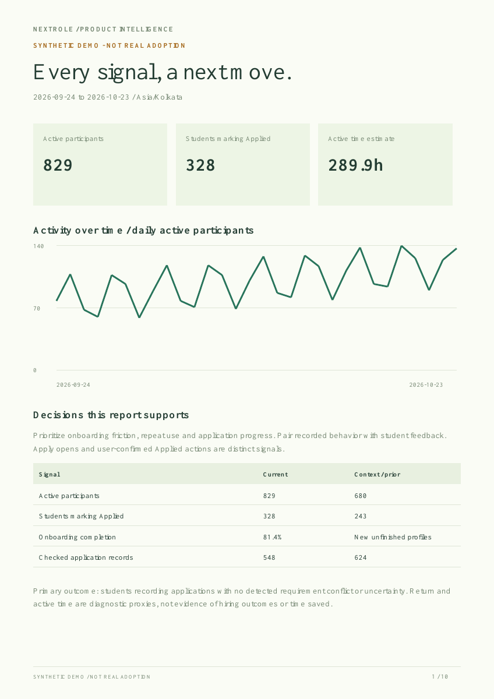
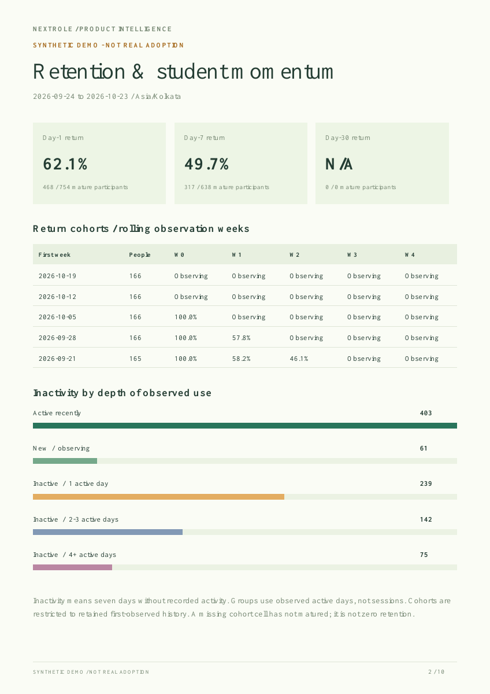
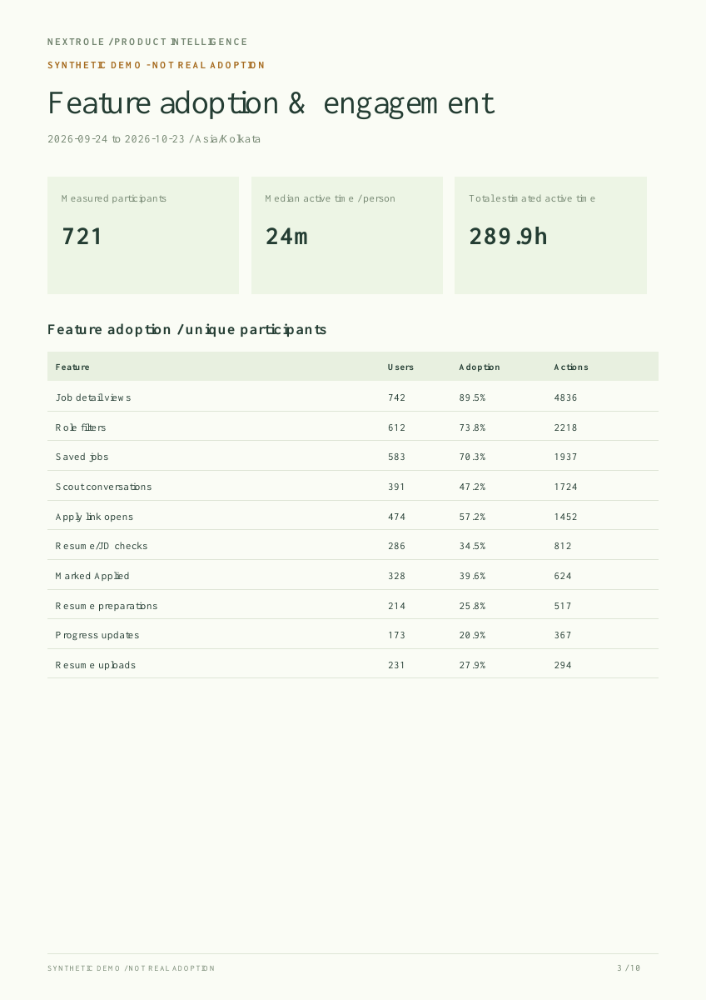
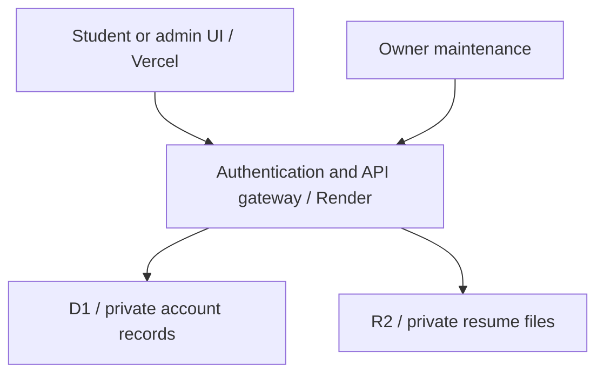

# NextRole

**A calmer job search. A measurable product.**

NextRole helps students and early-career candidates discover relevant openings, prepare a truthful résumé with ScoutX, and keep their applications moving. Its separate admin workspace closes the product loop: understand adoption, diagnose drop-offs, listen to students and decide what to improve.

[Open NextRole](https://nextrole-scout.vercel.app) · [Explore the synthetic admin demo](https://nextrole-scout.vercel.app/demo/admin) · [Measurement handbook](handoff/ADMIN-ANALYTICS.md) · [Render migration](handoff/RENDER-MIGRATION.md)

> **Scout city revision:** the approved NEXT JOB city scene and page-specific Scout actions build on the ivory/orange/teal Trail design. The running mascot loader and sidebar ScoutX entry have been removed; the floating assistant and full-page conversation remain. [Design targets and release notes](handoff/SCOUT-CITY.md) document the changes. [Browser design QA](design-qa.md) remains blocked by preview infrastructure; deployment receipts establish release status separately.

> **Portfolio data disclosure:** the public admin demonstration and report images below use synthetic, illustrative data. The example 973 profiles are not a real campus adoption claim. Live admin analytics use actual recorded activity and are owner-only.

## The product problem

Students lose time repeatedly checking career pages, discovering ineligible roles, preparing the same information and remembering what they applied for. A larger feed alone does not solve that problem. NextRole prioritizes clear eligibility evidence, persistent choices and an actionable application workflow.

The product hypothesis is that reliable relevance and a simpler preparation/tracking loop help candidates act on suitable opportunities and return when they need to. That hypothesis needs real pilot evidence; feature availability and demo charts do not prove product-market fit.

## What a student can do

- Set role, location, work arrangement, experience, graduation and supported academic preferences. Explicit conflicts are excluded from the preferred feed; missing evidence stays uncertain.
- Open a complete job page with its source and JD. Save it, dismiss it, or separately confirm Applied. Choices, notes and history survive source refreshes.
- Talk to ScoutX about the current job, attach an original PDF and check résumé/JD compatibility. Review tailored facts, then export PDF and LaTeX using a fixed template.
- Track application milestones, prepare using clearly labelled evidence/practice material, and export personal progress.
- Choose optional alerts, nightly email and feedback. AI calls use the student's explicitly configured providers; shared source discovery does not require student API keys.

Compatibility is an internal estimate, not an employer ATS result. Source coverage is limited to configured feeds and supported discovery/import workflows; the product does not claim access to every job board or universal automatic application submission.

## Admin intelligence

The host opens a dedicated `/admin` experience instead of a personal job feed. Six views connect behavior, feedback and reliability.

| View | What the team learns | Decision it supports |
| --- | --- | --- |
| Overview | Active reach, application action, exact Day-7 return, active-time estimate, onboarding and checked application records | Is the core loop producing useful action? |
| Retention | Mature return cohorts, Day-1/7/30 return, active-day frequency and inactivity after 1 / 2–3 / 4+ active days | Where does momentum fade? |
| Feature adoption | Unique participants, adoption, actions per user, complete-period comparisons and time by section | Which features deserve improvement or simplification? |
| Application journey | Ordered participant visit → job view → Apply open → Marked Applied; current tracked stages | Where should the workflow be investigated? |
| Feedback & help | Voluntary ratings, selected feedback categories, monthly needs, inbox triage and reply/resolution timing | What do students say is getting in their way? |
| Operations | Source health, refresh age, delivery backlog, email readiness, retained records and analytics cleanup | Is the experience dependable enough to expand? |

The dashboard offers an actual PDF report, a PDF for each section, summary CSV and full aggregate JSON. Reports include definitions, observation coverage and exact daily tables. Private messages and student identities do not appear in analytics reports.

### Exported report previews

These are rendered pages from the actual PDF exporter using the synthetic fixture. They are **report previews, not browser screenshots or evidence of production adoption**. Browser screenshots should be captured from the demo after real device QA.



| Retention report | Feature adoption report |
| --- | --- |
|  |  |

[Download the synthetic sample PDF](output/pdf/NextRole_Synthetic_Demo_Analytics.pdf)

## How a product manager would measure it

The north-star candidate is **students recording applications with no detected requirement conflict or uncertainty**. It pairs an action with the quality of the evidence available at confirmation. It remains a proxy: NextRole cannot verify employer acceptance or complete eligibility from incomplete source text.

| Measure | Definition and interpretation |
| --- | --- |
| Active participants | Distinct accounts with recorded activity in the same selected IST window. Not verified campus enrollment. |
| Feature adoption | Distinct accounts using a feature / accounts active in that window. Repetition is reported separately as actions per user. |
| Day-7 return | Exact seventh-day activity / first-observed accounts with a full seven days of follow-up. Immature cohorts are excluded. |
| Active time | Visible, focused and recently used time estimate. It is neither open-tab wall time nor time saved. |
| Inactive after one use | One recorded active day, with at least seven days since last activity. It is not a session count or a verified reason for leaving. |
| Journey drop-off | Ordered unique-account steps during the window; may involve different jobs. It is not same-job submission conversion. |

No retention target or impact percentage is invented for the portfolio. Establish a pilot baseline, review relevance and feedback alongside return, then predefine the success metric for each change. Avoid optimizing raw time spent or clicks when the candidate's goal is to complete their task efficiently.

### Tracking active time responsibly

The browser samples elapsed monotonic time only while the page is visible, focused and used within the previous 60 seconds. It observes interaction timestamps, not typed content. Large suspended-clock gaps are discarded.

The authenticated server validates a small, allowlisted sample payload. Cumulative per-account minute maxima make retries and overlapping tabs idempotent; atomic triggers add only the delta to daily section totals. The first accepted section receives that minute. Sequential tab switches, throttling or lost requests can undercount, so the UI calls this an estimate.

Host actions are excluded. Analytics opt-out removes the participant's events, cohorts, minute ledger and daily time totals; subsequent requests remain disabled. Workspace deletion does the same. Student data export includes their own daily time estimates. The ledger expires after 48 hours, events/daily aggregates after 90 days. Cleanup resumes through the existing bounded maintenance workflow.

See the [complete event/metric definitions and caveats](handoff/ADMIN-ANALYTICS.md).

## Architecture and deployment status

The deployed product uses a Vercel Next.js frontend, a stateless Render authentication/API gateway, and an owner-authorized Site data service with Cloudflare D1 and private R2. The native Site remains available. Existing maintenance tools preserve source, alert and delivery checkpoints.



Render runs the Google-authentication/API tier; the frontend's forwarding mode needs no OAuth/signing secrets. Existing storage and canonical account IDs remain in place. Live checks verify Google configuration, authorization redirects, secure cookies and anonymous access boundaries. An actual account owner's consent/token exchange and account linking require that owner's sign-in. The [cutover guide](handoff/RENDER-MIGRATION.md) explains verification and rollback; a full database migration is not claimed.

Google-only sign-in is gated until existing accounts are linked safely. Students can connect Google from Preferences; admins have a dedicated **Account** entry and `/account` page. No password login is introduced. The current working sign-in remains during the transition.

## Run and verify

Use Node 22.13+ with the package manager pinned in `package.json`.

```bash
corepack pnpm install --frozen-lockfile
pnpm dev
pnpm typecheck
node --experimental-strip-types scripts/verify-app.mjs
node --experimental-strip-types scripts/verify-app.mjs --scale
node --experimental-strip-types scripts/export-demo-report.mjs
```

`/demo/admin` works with synthetic data and no student/provider credentials. Live APIs require real identity and configured storage. Native hosting uses the repository's existing Sites build integration. To prepare a conventional frontend or the Render service:

```bash
node scripts/prepare-vercel.mjs --out /absolute/empty/frontend
node scripts/prepare-render.mjs --out .deploy/render
# After Render is configured and verified:
node scripts/prepare-vercel.mjs --out /absolute/empty/render-frontend --render-backend
```

Use the [environment guide](handoff/ENVIRONMENT.md), [Vercel guide](handoff/VERCEL.md) and [Render migration guide](handoff/RENDER-MIGRATION.md). Never commit secrets or student data. The blueprint leaves secret values for secure configuration.

## Evidence and honest limits

The isolated regression suite covers eligibility boundaries, persistent application state, account isolation, encrypted provider keys, owner access, consent, time deduplication, cleanup and PDF export. Separate generated-handler checks cover Google OIDC/session boundaries and the Render-to-Vercel forwarding mode. Synthetic load checks exercise bounded catalogues and maintenance; they are not proof of production capacity.

Real Google sign-in, real browser/device accessibility, campus concurrency, provider billing and Render cold-start behavior need rollout checks. Current job-board restrictions, browser-store approval and conditional email activation are documented rather than hidden behind placeholder success messages.

## Source map

- `app/host-dashboard.tsx`, `app/admin.css`: dedicated analytics workspace and synthetic demo.
- `lib/admin-analytics.ts`, `lib/host-metrics.ts`: aggregate queries and coverage.
- `app/use-active-time.ts`, `lib/activity.ts`, migration `0015`: active-time estimate and atomic deduplication.
- `lib/admin-pdf.ts`: vector PDF report and methodology appendix.
- `app/scout-chat.tsx`, `lib/scout*`: job-aware assistant and reviewed résumé workflow.
- `scripts/prepare-vercel.mjs`, `scripts/prepare-render.mjs`, `render.yaml`: reproducible deployment variants.
- `scripts/verify-*.mjs`, `handoff/`: executable evidence and operational handoff.

NextRole is a product case study in making a narrow job-search loop useful, measurable and understandable before claiming large-scale impact.
