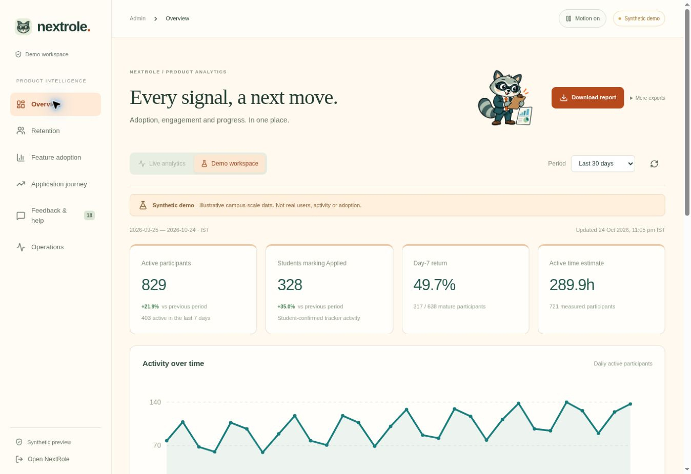
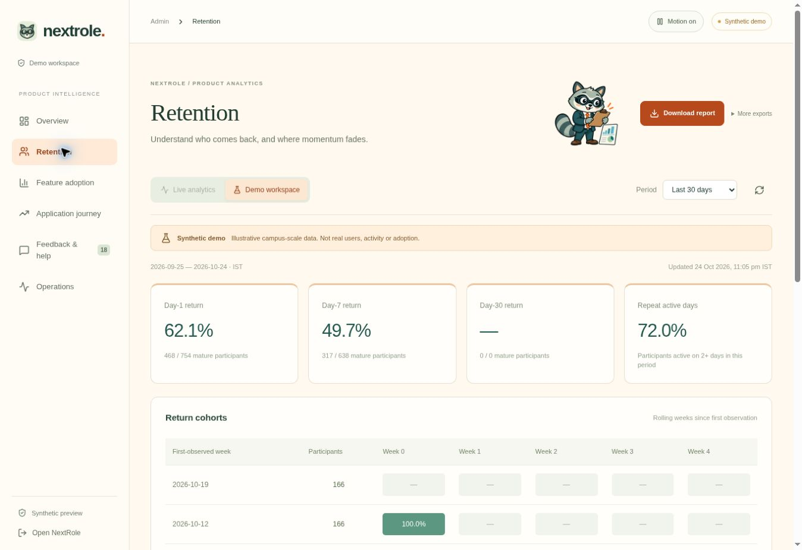
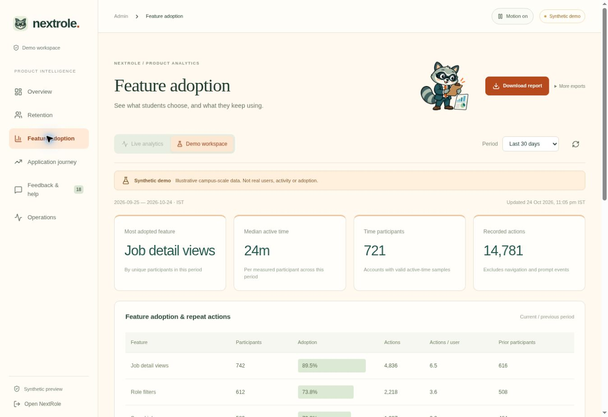
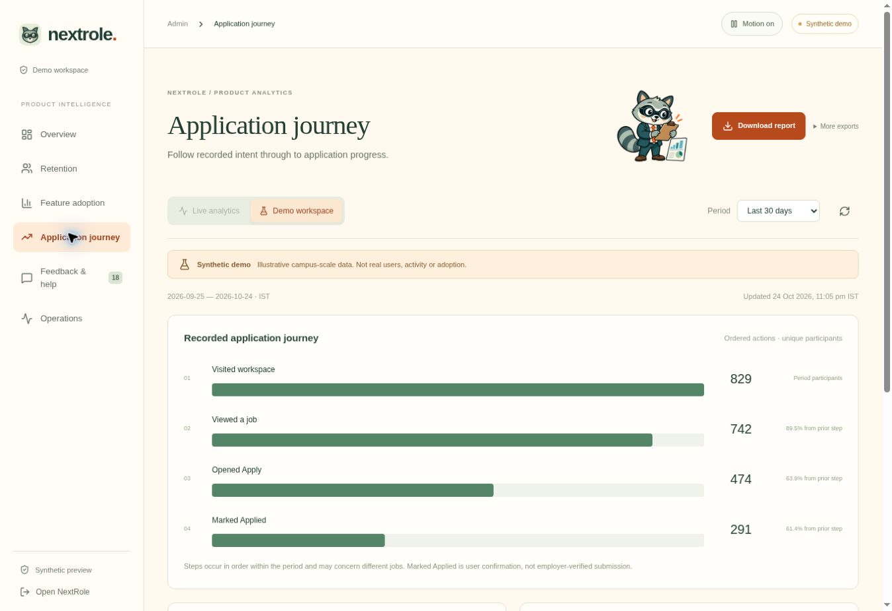
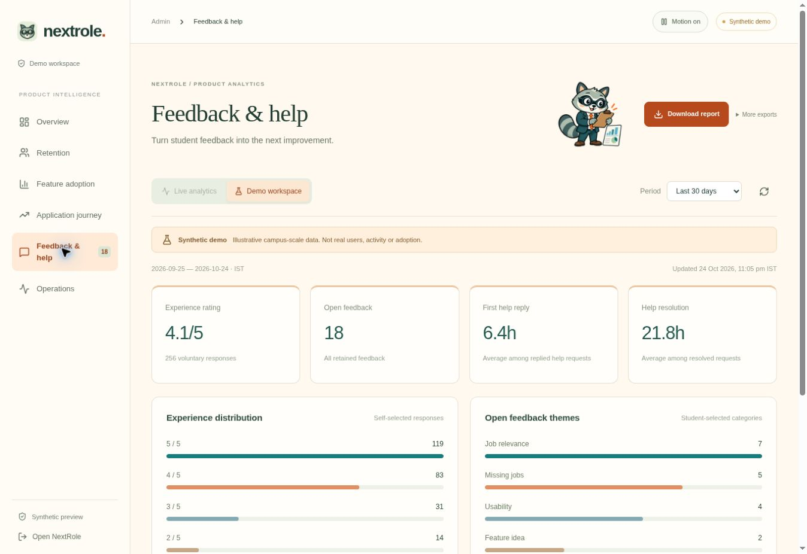

# NextRole product management case study

[Use NextRole](https://nextrole-scout.vercel.app/) · [Explore the synthetic admin demo](https://nextrole-scout.vercel.app/demo/admin)

NextRole helps final-year students discover relevant openings, prepare with job-context ScoutX assistance and track their applications. The product focuses on experience and graduation eligibility, source transparency and student control over application submission.

## Evidence disclosure

**Every analytics screenshot below contains SYNTHETIC DEMO DATA. These are not real campus users, retention, ratings, placements or time saved.** The demo uses a 920-participant observed pool, not 973 verified users. The 30-day period has 829 active participants. The counts illustrate the analytics product and measurement definitions only. No production records were changed to create this gallery.

Captured 24 October 2026 from the public, labelled demo. Source range: 25 September–24 October 2026, IST. Actual adoption has not been established by this portfolio.

## User problem and product response

A student should not repeatedly discover that an apparently suitable role needs several years of experience. NextRole keeps confirmed relevance separate from uncertain eligibility, stores preferences, and remembers Applied, Interested and Not interested choices. Opening an apply link differs from confirming an application.

ScoutX supports résumé/PDF discussion in the context of a job, compatibility guidance and fixed-template résumé preparation. Its compatibility metric is not an employer ATS score. Optional AI uses the student's separately configured provider connection and limits. Job discovery and tracking do not require an AI key.

## Analytics overview

The 920 participants describe the retained observed pool. 829 are active in the displayed period and 403 in the last seven days. The dashboard shows 328 users marking Applied. These examples are synthetic.

## Cohort retention

Day-7 return is 317 / 638 mature participants, or 49.7%. Immature observations stay outside the denominator. Day-30 has no mature sample, so it remains unavailable. Weekly cohort return differs from exact day-N return.

## Feature adoption

Examples: 742 job-detail users, 612 filter users, 583 saved-job users, 391 Scout users and 286 résumé/JD-check users out of 829 period participants. Adoption alone does not establish usefulness. Measure exposure and repeat value before interpreting non-use.

## Application journey

Ordered participants: 829 workspace visitors, 742 job viewers, 474 Apply openers and 291 Applied confirmations. The 291 ordered participants differ from the 328 feature users. Steps may concern different jobs. This is not an employer-verified same-job conversion funnel.

## Feedback and ratings

4.1/5 across 256 synthetic voluntary responses. 18 synthetic open items: relevance 7, missing jobs 5, usability 4, ideas 2. These are not testimonials or observed customer satisfaction.

## Proposed North Star metric

Weekly distinct students confirming at least one application with no detected eligibility conflict. Report unknown eligibility separately. The metric measures user-confirmed progress, not employer submission or placements. Supporting measures include activation, mature-cohort return, source freshness, mismatch reports, delivery opt-outs and preparation usefulness.

Active time estimates count visible, focused, recently used time. They do not measure productivity or time saved. Longer sessions are not automatically better.

## Current limits and next experiments

- Scout Companion code exists, but Chrome Web Store publication is pending.
- Automatic LinkedIn, Unstop and Internshala feeds are not connected. Saving a link and pasted JD is different from platform ingestion.
- Users submit applications on employer sites and confirm them in NextRole. Autonomous submission is not claimed.
- Nightly email depends on verified sender setup and student opt-in.
- Sourced OA/interview preparation, device coverage and production campus-load checks need further validation.
- Proposed experiments: audit 100 fresher matches, run 10–15 student usability sessions, test Scout entry-point discoverability, then run an opt-in campus pilot.

## Résumé-safe project description

Built and deployed NextRole, a fresher job-search workspace with preference-based discovery, job-context résumé assistance and application tracking. Designed opt-in product analytics and a labelled synthetic dashboard to evaluate activation, cohort retention and feature adoption.

Do not add “920 users,” “973 users,” “49.7% retention achieved,” ratings, placement impact or hours saved to a résumé until verified production evidence supports those claims.

## Research sources

- [AISHE official portal](https://aishe.gov.in/) and [2023–24 report](https://cdnbbsr.s3waas.gov.in/s392049debbe566ca5782a3045cf300a3c/uploads/2026/07/202607131602421770.pdf): higher-education context, not the count of active job seekers.
- [LinkedIn job alerts](https://www.linkedin.com/help/linkedin/answer/a511279/job-alerts-on-linkedin)
- [Teal workflow](https://www.tealhq.com/how-it-works)
- [Simplify Copilot setup](https://help.simplify.jobs/en/help/articles/1749022-install-and-set-up-copilot)

Competitor capabilities overlap. NextRole's fresher-focused relevance is a positioning hypothesis to test, not a proven competitive advantage.
