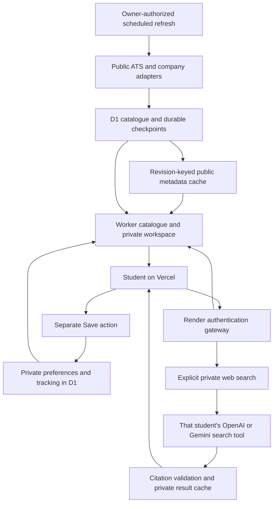

# NextRole: scalable discovery, HLD and LLD

## Decision and implementation status

Use a shared, durable catalogue collected once for everyone, then apply private preferences and tracking at read time. Cache public vacancy metadata, not authenticated responses. Provide an explicit, private, grounded web search for opportunities beyond connected feeds. An LLM without a live retrieval tool cannot enumerate current vacancies or guarantee market completeness.

Implemented in this change:

- Revision-keyed public catalogue chunk cache, bounded in-memory LRU, Cloudflare Cache API, cache-miss coalescing and an optional Upstash Redis REST adapter.
- Fresh private status/note overlays, existing per-account ranked snapshots, stable cursors, indexed page hydration and database revision fencing.
- OpenAI web search and Gemini Google Search grounding using the requesting account's encrypted API connection. Concrete source URLs must be present in provider search evidence. Searches and results remain private.
- Six-hour private AI-search cache, explicit credit consent, daily AI-check allowance, request limits, separate Save action and preservation of existing Applied/Not interested choices.
- Companies render from the actual configured source registry before personalised counts finish. Missing counts use an em dash rather than an invented zero.

The existing enabled source-refresh automation is already scheduled for **10:00 and 18:00 Asia/Kolkata**. It uses public source adapters and optional owner-configured search-index discovery. It never uses student AI keys. Nightly opted-in email remains separate.

**Redis activation status:** no owner Redis endpoint or Render Key Value instance was configured at inspection. The cache operates using the existing Worker memory and Cache API, with authoritative database fallback. The Redis adapter is implemented but is not an active Redis deployment. No additional paid resource was provisioned.

## High-level design

Vercel hosts the UI. The existing stateless Render service verifies Google/email sessions and proxies fixed API routes. The existing Worker data service owns D1, private R2 files, source collectors and encrypted personal AI keys. Redis, when connected, is disposable cache storage; it is never the account database or application-history source of truth.

## Domain ownership and API contracts

| Domain | Durable truth | API or worker boundary |
| --- | --- | --- |
| Public jobs | D1 `jobs`, source runs and checkpoints | Owner-only `nextrole_refresh_sources`; authenticated catalogue reads |
| Preferences | D1 `profiles` and workspace revision | Existing authenticated profile actions |
| Decisions, notes and history | D1 `user_jobs`, application records/events | Explicit personal actions; freshly hydrated |
| Ranked pages | Per-account `catalogue_snapshots` | `GET /api/catalogue`; 20 default, 100 maximum per page |
| Private web leads | Per-account `analyses`, six-hour freshness | `POST /api/market` action `search` |
| Saved web lead | Per-account import or existing canonical shared job | `POST /api/market` action `save` |
| Résumés and generated files | Existing private R2 and D1 metadata | Existing owner-scoped file APIs |
| Notifications and email | Existing opt-ins, alert checkpoints and delivery outbox | Existing authorized workers; no change to opt-ins |

`search` accepts a 2–300 character query, the supported company/role/arrangement/view filters and `consent: USE_MY_WEB_SEARCH_CREDITS`. It returns up to eight sourced leads, a private result ID, source links, retrieval time, provider and cache indicator. Search sends job preferences only: role, location, work arrangement, experience, job type and graduation year. It does not send identity, grades, notes, résumé files or application history.

`save` accepts that account's unexpired result ID and an exact returned URL. It reads the saved server result, not client-supplied vacancy content. Another account's result ID is rejected. A canonical shared job is reused; existing private imports and tracking choices are preserved. New private leads remain availability-unknown with incomplete eligibility evidence. Saving never submits an application.

All personal responses remain `Cache-Control: no-store`. Authentication and fresh tracking still require backend requests; caching removes repeated expensive catalogue reads, not authorization.

## Low-level cache design

| Layer | Key / content | Bound and invalidation |
| --- | --- | --- |
| Worker LRU | Project namespace + cache version + catalogue revision + row cursor; public metadata only | At most 64 chunks / 12 MiB per isolate; five-minute TTL |
| Cloudflare Cache API | Same revision key; only public metadata | At most 250 rows and 2 MiB per chunk; five-minute TTL; cache is local to a Cloudflare data centre |
| Optional Redis REST | Same project/revision key | HTTPS-only owner-configured Upstash hostname; GET and SET with EX 300; bounded bodies; 900 ms call timeout |
| Private ranked snapshot | User ID + filter hash + catalogue/profile/workspace generation | Existing five-minute maximum; shorter at freshness/deadline boundaries; private mutation and catalogue revisions invalidate cursors |
| Private AI result cache | User ID + provider/model/key fingerprint + public search/filter payload | Six hours; respects existing 200-result retention per account; expiry enforced when saving |

Read flow:

1. Read the account's profile, workspace revision and shared catalogue revision.
2. Reuse a valid private ranking snapshot; otherwise read public chunks from LRU, optional Redis, Cache API, then D1.
3. Coalesce concurrent misses for the same public chunk within an isolate. Across isolates, bounded chunks and the existing D1 budget remain the fallback; this is not a global distributed lock.
4. Read the account's tracking separately and apply it to cached public metadata. Read closed tracked openings and personal imports privately.
5. Rank/filter, persist only private references and counts, and hydrate the requested page through indexed row lookups.
6. Fence the result against current revisions. A concurrent source/profile/status change returns a recoverable 409 rather than mixing generations.

D1 triggers advance the public revision on job inserts, updates and deletes. Personal changes advance a separate user revision. Old revision cache keys are unreachable immediately and expire naturally; the design does not depend on every invalidation message arriving. Oversized chunks bypass caching. Corrupt, unavailable or rate-limited cache services fall back to the database. A Redis failure opens a 30-second per-isolate circuit breaker.

Host operational data includes cache mode and hit/miss/fallback counters. These counters are explicitly **per isolate, resetting on restart**, not a global hit-rate claim.

## Grounded discovery and credit ownership

OpenAI uses the Responses `web_search` tool, requires a tool invocation, requests source metadata and limits the request to two hosted tool calls. GPT-5 search uses `low` reasoning rather than unsupported `minimal` search reasoning.

Gemini uses `googleSearch` grounding. Its fixed Google citation redirects can be resolved without fetching the destination career page. Returned Google Search suggestion markup is preserved in a sandboxed iframe without script or same-origin privileges. Search/token charges are the student's provider charges; Gemini may issue multiple search queries inside a request, so an app request allowance is not a precise currency cap.

A model's generated URL is insufficient: the canonical URL must occur in actual provider source metadata, have a concrete vacancy path and pass HTTPS/public-host validation. Generic search/careers indexes, private endpoints, unexpected ports and uncited links are excluded. Page text is untrusted data and cannot trigger tools, change settings, submit applications or enable alerts.

Confirmed quota/rate-limit failures may try the next enabled supported connection only if the account enabled fallback. A timeout, ambiguous acceptance, missing grounding or unusable response stops the web-search request. No automatic replay is made. Groq remains usable for its existing AI tasks; it is not represented as having an implemented live web-search tool.

Web search is on demand. Existing ordinary feeds, keyword search, preference matching, tracking and scheduled alerts remain available without any AI key. Web results expand discovery beyond the configured employer list but cannot establish complete coverage, current application acceptance or eligibility.

## Reliability, cost and scaling gates

The current catalogue ranking budget remains **20,000 scanned rows**. This change does not remove safety limits or prove 1,000 concurrent production users. More registered users and more simultaneous catalogue builds are different workloads. Cache misses, model requests and free Render cold starts still have latency and quota costs.

| Signal to measure | Next decision |
| --- | --- |
| Warm API p50/p95, cold-build p95 and 409 rate during sweeps | Tune cache size/TTL and source batching using real observations |
| D1 rows read per catalogue request; shared-cache hit/fallback counts | Connect Redis if cross-isolate reuse and measured query savings justify it |
| Catalogue approaching 20,000 rows or cold ranking becoming CPU-bound | Add indexed eligibility/search projections or an appropriate dedicated search database before raising the cap |
| 50/100/250/1,000 concurrent realistic authenticated sessions | Measure latency, failures, CPU, database reads and cold-start behavior; publish results only after the load run |
| Render queueing/cold starts affecting user journeys | Revisit gateway plan/capacity with the owner, using measured traffic and cost |
| AI requests per user, grounded-result yield and rejected citation counts | Adjust supported models, prompt/evaluation fixtures and disclosed per-user budgets |

Use a modular application rather than adding independent services for every feature. If ingestion volume outgrows resumable owner workers, the next step is a durable queue with provider-specific concurrency and delayed retries. A PostgreSQL migration is an explicit future data-migration project, not something this cache change pretends to complete.

## Redis connection procedure

Use an owner-controlled persistent Upstash database. Add `UPSTASH_REDIS_REST_URL` and secret `UPSTASH_REDIS_REST_TOKEN` to the Worker **data service** environment. Do not place them in frontend/public environment variables. The endpoint must be a root HTTPS `*.upstash.io` URL. Keep regional placement near the data service and review the account's current request/storage allowance. The cache automatically uses it once configured; removing it returns to memory/edge/database fallback without losing user data.

The adapter is HTTP-based because this Worker deployment does not use raw TCP. An internal Render Redis endpoint is not directly interchangeable with this REST interface. Provisioning a temporary anonymous Redis database would not satisfy owner-controlled production storage.

## Validation

Run:

- `node --experimental-strip-types scripts/verify-scalability.mjs`
- `node --experimental-strip-types scripts/verify-app.mjs --scale`
- `pnpm typecheck`
- Native Worker build and generated Next.js frontend checks.

The focused suite verifies actual catalogue/history behavior, cache miss collapse, TTL and revision invalidation, Redis failure/hit paths, account isolation, credit consent, citation validation, six-hour private results, explicit saving, ambiguous request handling and the actual Companies component showing Google/Revvity while counts are pending. Provider responses and large catalogues in tests are isolated fixtures, not user adoption or production capacity metrics.

## Primary references

- Cloudflare Cache API: https://developers.cloudflare.com/workers/runtime-apis/cache/
- Upstash Redis REST API: https://upstash.com/docs/redis/features/restapi
- OpenAI web search: https://developers.openai.com/api/docs/guides/tools-web-search
- Gemini Google Search grounding: https://ai.google.dev/gemini-api/docs/google-search
